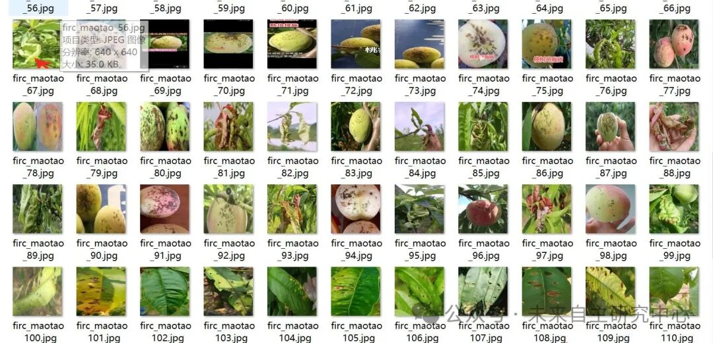
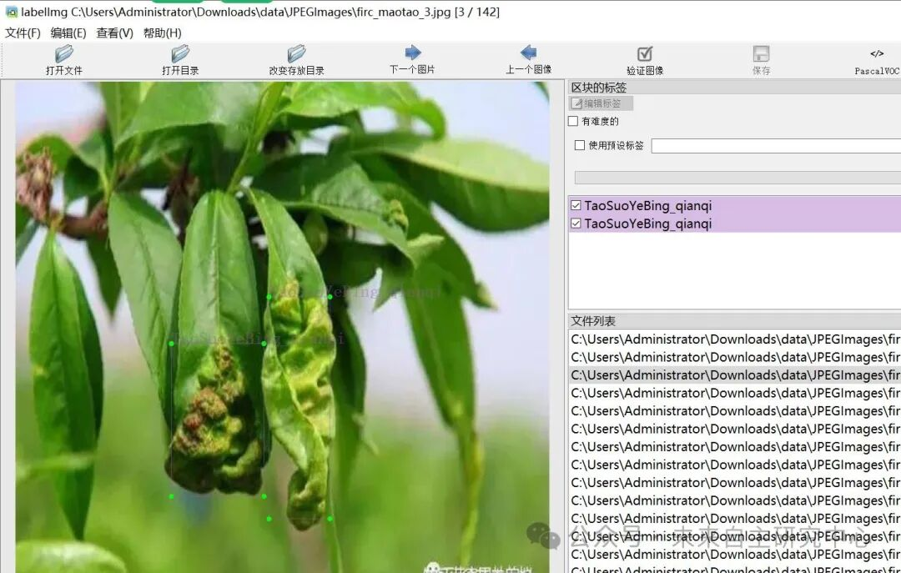

# Maotao Disease Detection Dataset VOC+YOLO format with 142 images in 4 categories

Dataset format: Pascal VOC format + YOLO format (txt file without split path, only containing jpg images and corresponding VOC format xml files and yolo format txt files)

Number of images (number of jpg files): 142

Number of annotations (number of xml files): 142

Number of annotations (number of txt files): 142

Label count: 6

Annotation Category Names: ["TaoChuanKongBing_houqi", "TaoChuanKongBing_qianqi", "TaoChuangJiaBing_houqi", "TaoChuangJiaBing_qianqi", "TaoSuoYeBing_houqi", "TaoSuoYeBing_qianqi"] => ["TaoChuanKongBing_houqi", "TaoChuanKongBing_qianqi", "TaoChuangJiaBing_houqi", "TaoChuangJiaBing_qianqi", "TaoSuoYeBing_houqi", "TaoSuoYeBing_qianqi"]

Number of boxes labeled in each category:

TaoChuanKongBing_houqi Frames = 34

TaoChuanKongBing_qianqi Frames = 16

TaoChuangJiaBing_houqi Frames = 26

TaoChuangJiaBing_qianqi Frames = 48

TaoSuoYeBing_houqi Frames = 41

TaoSuoYeBing_qianqi Frames = 33

Total frame count: 198

Using labelImg:

Annotation rules: Draw a rectangle around the category.

Important Notice: No

Special : This dataset does not guarantee the accuracy or precision of the trained models or weight files. The dataset is provided with accurate and reasonable annotations only.

Image Preview:

Annotation example:

## Payment

Here is a pay link on Stripe ( https://buy.stripe.com/3cs8yP7sY87d0vu9AB ). Please contact me lonlonago@foxmail.com after funding $89, and I will send you a complete data files , thank you!

